# room_english · 三间房 3D 英语探索 设计（2026-10-24，2026-10-25 扩建厨房，2026-10-26 扩建两间卧室）

## 1. 背景与目标

小星英语老师需要一个「能把孩子带进房间」的词汇教学工具：不是看图选词，而是让孩子在可旋转的 3D 客餐厅里点家具、听英文发音、看单词卡，把单词和实物对应起来。

原型来自 open-design（`kids-room-3d-english`，8m × 6m 低多边形客餐厅、25 件可点击物品、three.js 0.185 本地渲染）；2026-10-25 参考同系列厨房原型（`96a8ae19-…`，东北角开放厨房方案）向东扩出开放厨房，房间变成 11.8m × 6m、37 件可点击物品（客厅 15 + 餐厅 10 + 厨房 12，见 §11）。2026-10-26 再参考 `kids-3d-bedrooms-wing`（`.od/projects/6fb4d3ef-…`）补上儿童房与主卧，可点物品 37 → 61，页面顶部多了房间切换标签（见 §12）。本设计把它落到鸿蒙原生壳里，作为一个内置工具 `room_english` 挂在 `ToolRegistry` 上，由小星英语老师在「呈现」环节调用。

## 2. 方案选型

| 方案 | 结论 | 理由 |
| --- | --- | --- |
| **Web 容器 + rawfile 本地页面（采用）** | `Web` 组件加载 `resource://rawfile/room3d/index.html`，three.js / 字体 / CSS 全部打包在 rawfile，无网络依赖 | 原型是 three.js 网页，1:1 保真、零几何重写；项目里 `mermaid` / `document-parser` 已用同法加载 rawfile 页面并加载相对子资源，路径可靠 |
| ArkGraphics 3D 原生场景 | 不采用 | 原型是程序化低多边形几何（非 glTF），要重建成 glTF 资源 + 原生拾取/标签投影，工作量大且丢失原型视觉 |
| 原生 ArkUI 伪 3D | 不采用 | 旋转相机、悬停高亮、标签避让都需重写，效果不如原型 |

**边界**：ArkWeb 没有 `speechSynthesis`，发音改走原生 TTS 桥；原生标题栏接管「进度 + 我学会了」，页面切到 host 布局（隐藏自带品牌栏）。

## 3. 数据：61 个物品

`sofa / coffee_table / tv / tv_stand / remote_control / rug / cushion / floor_lamp / bookshelf / book / plant / curtain / window / picture / clock`（客厅 15）+ `air_conditioner / trash_can / dining_table / dining_chair / plate / bowl / cup / spoon / fork / kettle`（餐厅 10）+ `fridge / stove / oven / sink / pot / pan / toaster / microwave / dishwasher / cabinet / knife / stool`（厨房 12）。

儿童房 12：`bed / desk / chair / wardrobe / toy_box / round_rug / bookcase / shelf / basket / poster / blanket / toy_car`；主卧 12：`double_bed / nightstand / lamp / pillow / closet / dresser / mirror / stool_master / bench / rug_master / heater / photo_frame`（2026-10-26 新增，见 §12）。

每个物品带 `word / phonetic / zh / kidDefinition / example / category / room`，唯一数据源是 `rawfile/room3d/assets/scene-data.js`，工具侧校验白名单是 `utils/RoomEnglishValidation.ets` 的 `ROOM_OBJECT_IDS`。**两处必须同步**（单元测试断言 61 条）。

> 原型把空气调节器/垃圾桶归到餐厅（10 条），保持原分组不动。
> 网页内的总数、分类计数、进度分母全部由 `scene-data.js` 派生（`data-total` / `OBJECTS.length` / `categories[x].count`），只有 `RoomEnglishCard` 的原生标题栏需要常量 `ROOM_OBJECT_TOTAL`。

## 4. 工具契约

### 4.1 参数（schema 见 `config/BuiltinTools.ets`）

| 字段 | 类型 | 必填 | 说明 |
| --- | --- | --- | --- |
| `skill_key` | string enum `english_vocab` | 是 | 画像维度固定为英语词汇 |
| `focus` | string enum `living` / `dining` / `kitchen` / `child` / `master` / `all` | 否 | 默认 `all`；`child` / `master` 会让卡片直接切到那间卧室，其余值只进 payload + 文案 |
| `words` | string[] | 否 | 本次重点词 id，最多 8 个；命中后自动选中第一个词（2026-10-24 起英文标签默认隐藏，由孩子点场景「显示英文标签」开关手动打开；选中物品即自动朗读） |

### 4.2 回执（`ToolResult.result`）

```json
{
  "completed": true,
  "explored_count": 7,
  "words": ["sofa", "tv", "rug"],
  "focus": "all",
  "skill_key": "english_vocab",
  "cancelled": false
}
```

- 孩子点「我学会了」→ `completed: true` + 已点开物品清单。
- 直接关掉 sheet → `completed: false, cancelled: true`（ChatPage 的 `onDisappear` 兜底）。
- 预校验失败（坏 JSON / skill_key 错 / 非法 focus / 非法 word id / 超过 8 个词）→ `{ error: "validation_failed", should_retry: true }`，AI 自行修正。

## 5. 前端结构

`components/room/RoomEnglishCard.ets`

```
Column
├─ HeaderBar()            原生：标题 + 已收集 N/61 + 「我学会了」
└─ Stack
   ├─ Web(resource://rawfile/room3d/index.html)
   ├─ LoadingProgress     页面就绪前的「正在布置小房间…」
   └─ 错误面板 + 重新加载
```

- `isAnswered` 模式下不加载 Web，只渲染收集到的单词 chips（时间线回看用；实际时间线由 MessageBubble 的 `RoomEnglishStepContent` 显示）。
- 页面就绪（`onPageEnd`）后先按 `focus` 注入 `window.WordRoomApp.setRoom(room)`（卧室 focus 才切房间），再按 `words` 注入 `select(first)`。

### 5.1 桥协议（`RoomNativeBridge`，`javaScriptProxy` 注入）

| 方向 | 方法 | 说明 |
| --- | --- | --- |
| Web → 原生 | `speak(word, zh)` | 返回 `'true'` 表示已交给原生 TTS；原生先念 `zh`（中文意思）再念 `word`。Web 侧据此跳过 `speechSynthesis` |
| Web → 原生 | `stopSpeak()` | 关闭单词卡 / 切词时停播 |
| Web → 原生 | `onReady()` | 3D 场景首帧就绪（Web 侧 loader 自行收起） |
| Web → 原生 | `onSelect(id, word)` | 选中物品，原生累计已收集单词 |
| Web → 原生 | `onProgress(idsJson)` | Web 侧 `discovered` 集合变化，原生以它为准覆盖进度 |

- Web 侧封装在 `assets/room-app.js` 的 `bridgeCall()`，桥缺失时全部降级为 no-op（浏览器里打开原型仍可用）。
- 原生侧状态写回统一走 `UIContext.runScopedTask`，避免 Web 代理回调线程直接改 `@Local`。
- `onSelect` / `onProgress` 同时带 id 与展示词：`words` 回执用 id（与工具白名单同口径），UI chips 用英文单词。

### 5.2 host 布局

`assets/room-host.css` 在 `body.room-host` 下隐藏页面自带 `.topbar` / `.skip-link`，`.workspace` 高度改 100dvh；原生 HeaderBar 顶替。该 class 由 `room-app.js` 无条件添加（这份 index.html 只在小词屋 sheet 里加载）。

## 6. 授星决定

**Decision：room_english 不授星**（与 `map_card` 一致）。

- 它是讲解型工具，没有对错判定；按项目规则「讲解课不是题」不记 `star_event`。
- 星星由小星老师在同一节课的后续 `english_quiz` / `matching_pairs` 给出（系统提示词里已明确写「room_english 本身不授星」）。
- 因此 **不改** `models/StarEventModels.ets` 与 `services/StarRewardService.ets`（10 处 drift 点全部跳过），也不出现在星星明细页。

## 7. 接入点（对照 `adding-mini-game-tool` 10 步配方）

| 步骤 | 文件 | 改动 |
| --- | --- | --- |
| 1 | `utils/SearchToolIdentityUtils.ets` | `ROOM_ENGLISH_TOOL_ID` + `isRoomEnglishFunctionName` + 加入 `isInteractiveQuizFunctionName` |
| 2 | `config/BuiltinTools.ets` | import、`RoomEnglishArgs`、`RoomEnglishExecutor`、`createRoomEnglishToolDefinition`、`createRoomEnglishToolConfig`、register、`getBuiltinToolIds` |
| 3 | `services/ToolExecutionService.ets` | import、`handleRoomEnglish`、dispatch（在 `resolveToolId` 之前） |
| 4a | `models/StarEventModels.ets` | **跳过**（见 §6） |
| 4b | `services/StarRewardService.ets` | **跳过**（见 §6） |
| 5 | `models/AssistantModels.ets` | import、默认助手 + 小星英语老师白名单、两段提示词 |
| 6 | `components/room/RoomEnglishCard.ets` | 新建（Web 容器 + 桥 + 完成回执） |
| 7 | `components/MessageBubble.ets` | import、`onOpenRoomEnglishSheet` @Event、待答横幅、7 处 step 判定、时间线回看 |
| 8 | `pages/ChatPage.ets` + `components/chat/ChatMessageListSection.ets` | 全屏 sheet 状态 / builder / `onDisappear` 兜底，事件透传 |
| 9 | 持久化 | **不需要**：仅 rawfile 静态资源，无用户数据 |
| 10 | 校验 | JSON.parse 26/26、`node --check` 4 个 JS、`assembleHap` 通过 |

## 8. 验收清单

- [ ] 小星老师调用 `room_english` 后，对话里出现「客餐厅 3D 英语探索 · 点击走进房间」横幅
- [ ] 点横幅打开全屏 sheet，3D 客餐厅渲染出来，可拖动旋转 / 双指缩放
- [ ] 点沙发 → 右侧（手机为下方）出现单词卡：sofa / /ˈsoʊfə/ / 沙发 / 儿童解释 / 例句
- [ ] 点物品后不用点「听发音」即自动听到原生 TTS 慢速（0.8）英文；「听发音」按钮保留作重播
- [ ] 再点电视 → 单词卡切换，不叠加；点空白处 → 关闭单词卡
- [ ] 原生标题栏进度从 0/37 递增；点「我学会了」→ sheet 关闭，AI 收到 `explored_count` 与 `words`
- [ ] 时间线里这条工具步骤可展开，显示收集到的单词 chips
- [ ] 传 `words: ["sofa"]` 时进房间自动选中沙发并自动朗读；英文标签默认不显示
- [ ] 直接下拉关闭 sheet → AI 收到 `cancelled: true`，不报错
- [ ] 非法 word id（如 `bathtub`）→ 工具返回 `should_retry`，AI 改用合法 id

## 9. 已知边界

- 3D 依赖 WebGL；极低端设备关闭硬件加速时显示「3D 房间没有打开」+ 重新加载，词汇表仍可在网页内使用（当前 sheet 直接展示错误面板，未做词汇表兜底）。
- 系统 TTS 必须已初始化（`EntryAbility` 已 init）；引擎不可用时返回 `'false'`，Web 侧回落到 `speechSynthesis`，再不行提示「当前设备不支持语音朗读」。
- `focus` 暂不裁剪场景（原型不支持按分类隐藏），只进回执与提示词。
- 房间变长后默认视角半径约 22（手机竖屏 402 × 874），厨房物品在默认缩放下偏小；已放宽缩放范围（`zoomRange()` 跟 `fitRadius()` 联动，可拉近到约 8），双指掰合即可贴近厨房。默认俯角也从 37° 收到 41°（`phi` 0.93 → 0.85），长条形户型在竖屏里更饱满。
- 深色模式下 Web 页自身主题固定浅色（原型只做了浅色），sheet 背景与原生标题栏会跟随深色，页内为浅色卡片，属预期。

## 10. 复原配色（2026-10-24 修复：整间房发灰）

**现象**：真机上 3D 房间几乎只有灰白色，家具分不出颜色。

**根因**：`room-models.js` 的 OKLCH→sRGB 转换把调色板里的 `L`（百分比，70–99）当成 0–1 直接立体方，三次方后全部溢出并被 clamp 成纯白——所有材质都成了 `#ffffff`，场景只剩灯光和阴影，所以是灰度图。这个 bug 在原型的网页版里同样存在（`linearSrgb` 与原型完全一致），不是 ArkWeb 的问题：本地 Chromium 渲染同一页面测得画面平均彩度 0.036、95% 像素近乎无色，与真机截图 0.034 / 98% 一致。

**修复**（三处，均在 rawfile 内）：

| 文件 | 改动 | 理由 |
| --- | --- | --- |
| `assets/room-models.js` | `lightness = L / 100` 后再参与 OKLCH→线性 sRGB 计算 | 真正的 bug：L 量纲错误导致全部材质纯白 |
| `assets/room-models.js` | 新增 `CHROMA_GAIN = 1.4`，`color()` 把彩度放大 1.4 倍（上限 0.4） | 原型配色是为大屏调的柔低彩度，缩到手机上半屏后颜色读不出来 |
| `assets/room-scene.js` | `ACESFilmicToneMapping` → `NeutralToneMapping`；曝光 1.05→1.0；hemi 1.55→0.85、key 2.35→1.45、fill 0.72→0.38、backFill 0.38→0.20 | ACES 会把「高亮 + 低彩度」的场景压成灰白；原光强叠加后过曝（1.55+2.35+0.72+0.38≈5.0） |

**效果**（同一视角、同一相机，`deviceScaleFactor: 2`）：

| | 画面平均彩度 | 近乎无色像素 | 最饱和色 |
| --- | --- | --- | --- |
| 修复前 | 0.032 | 95% | `#9ec1b0` 淡灰绿 |
| 修复后 | 0.144 | 45% | `#d89051` 陶土橙 |


**没有做的**：没有替换调色板本身。房间仍是原型那套「暖木色 + 鼠尾草绿 + 陶土色」的柔和北欧配色，地板/墙面本来就是暖中性色，所以整体基调偏米色；如果希望更「儿童房」的跳色（蓝/黄/粉撞色），那是配色改版，需另开一轮，参照物见 §11。

## 11. 厨房扩建（2026-10-25）

### 11.1 目标与取舍

原型里的 3D 房间只有客餐厅，孩子学家居词时「厨房」这一大类（fridge / stove / sink / pot / pan …）没有可点的实物。参考 open-design 厨房原型（单页 HTML，18 件厨房物品 + 平面「工作台」风格）后，决定在**同一个 3D 房间内向东扩出开放厨房**，而不是再开一个新页面：

- 保持「一间房就可以讲完」的叙事：孩子在客厅坐下 → 走到餐桌 → 进厨房，视角连续。
- 复用同一套 `RoomExperience`（相机/拾取/标签/桥），不新增 Web 容器，sheet 逻辑零改动。
- 词汇来源仍是 `scene-data.js` 单一数据源，原生侧只加白名单与 `focus` 枚举。

未采纳：把厨房做成第二个页面（切换成本高、老师讲「走进厨房」会断）、把厨房放在房间南侧（南墙是剖切面，会被相机挡）。

### 11.2 空间布局

房间底面从 `8.38 × 6.38` 扩到 `11.9 × 6.38`（x: −4.19 → 7.65），北墙、踢脚线、收口线同步延长；厨房占 x 4.2 → 7.65 的东北角，地面铺 0.84m 方砖（`RGB.tile` + 灰缝）与客餐厅木地板分开，北墙加石材压条 + 浅色墙砖。

| 家具 | 位置 (x, z) | 尺寸 | 说明 |
| --- | --- | --- | --- |
| 橱柜（柜体 + 石材台面） | 6.31, −2.70 | 2.0 × 0.6 × 0.87 | 一字型沿北墙，台面 2.14 × 0.72 @ y0.92 |
| 冰箱 fridge | 4.75, −2.58 | 0.92 × 0.7 × 1.94 | 台面西端独立高柜，两门 + 把手 + 磁贴 |
| 灶台 stove | 5.70, −2.68 | 0.8 × 0.48 | 黑玻璃面板 + 2 个深色炉圈 + 3 个旋钮 |
| 烟机 hood（装饰） | 5.70, −2.86 | 0.86 × 0.4 | 1.56m 高，含烟管 |
| 锅 pot / 平底锅 pan | 5.50 / 5.98, −2.72 / −2.66 | ⌀0.29 / ⌀0.32 | 坐在灶台玻璃上（y = 台面 + 0.026） |
| 烤箱 oven | 6.34, −2.36 | 0.64 × 0.64 | 嵌在柜体前脸，深色玻璃门 + 拉手 |
| 洗碗机 dishwasher | 6.98, −2.36 | 0.6 × 0.76 | 不锈钢面板 + 指示灯条 |
| 吊柜 cabinet | 6.60, −2.80 | 1.2 × 0.72 × 0.36 | y1.32–2.04，双门 + 黄铜拉手 + 柜底灯带 |
| 微波炉 microwave | 7.04, −2.62 | 0.54 × 0.38 | 站在 0.99m 小搁板上（搁板属装饰） |
| 中岛 island（装饰） | 5.95, −0.86 | 2.4 × 1.05 × 0.92 | 木柜体 + 米白门板 + 石材台面 |
| 水槽 sink | 5.40, −0.88 | 0.64 × 0.48 | 中岛台面上：不锈钢盆口 + 深色盆底 + 鹅颈龙头 |
| 烤面包机 toaster | 6.95, −0.88 | 0.3 × 0.19 × 0.19 | 中岛台面东端，橙色机身 |
| 刀座 knife | 6.45, −0.54 | 0.16 × 0.1 | 中岛台面南沿，木座 + 3 把刀 |
| 吧台凳 stool | 5.95, +0.18 | 2 × ⌀0.4 | 中岛南侧两把，座高 0.62 |

相机随之改成数据驱动：`WordRoomModels.bounds` 提供 `centerX / halfWidth / halfDepth`，`room-scene.js` 的 `orbit.target`、`fitRadius()`、`zoomRange()` 全部读它（原来写死的 `4.35 / 3.55 / 12.3..18.4 / 9.2..18.8` 会让 11.8m 的房间卡在取景外）。

### 11.3 新增单词（12）

| id | word | 音标 | 中文 | 儿童解释（≤20 字） | 例句 |
| --- | --- | --- | --- | --- | --- |
| fridge | fridge | /frɪdʒ/ | 冰箱 | 厨房里的大柜子，里面很冷。 | The milk is in the fridge. |
| stove | stove | /stoʊv/ | 灶台 | 上面有火，锅放在上面煮。 | Put the pot on the stove. |
| oven | oven | /ˈʌvən/ | 烤箱 | 关上门烤蛋糕和面包。 | The cake is in the oven. |
| sink | sink | /sɪŋk/ | 水槽 | 洗菜洗碗的水池，有龙头。 | Wash the apple in the sink. |
| pot | pot | /pɑːt/ | 锅 | 深深的锅，用来煮汤。 | The soup is in the pot. |
| pan | pan | /pæn/ | 平底锅 | 浅浅的锅，可以煎鸡蛋。 | Fry an egg in the pan. |
| toaster | toaster | /ˈtoʊstər/ | 烤面包机 | 放进面包，跳起来就好了。 | The toast pops out of the toaster. |
| microwave | microwave | /ˈmaɪkrəweɪv/ | 微波炉 | 一按就热，热牛奶很快。 | Heat the milk in the microwave. |
| dishwasher | dishwasher | /ˈdɪʃwɔːʃər/ | 洗碗机 | 把脏碗放进去，它会洗。 | Put the plates in the dishwasher. |
| cabinet | cabinet | /ˈkæbɪnət/ | 橱柜 | 墙上的柜子，收碗和杯子。 | The bowls are in the cabinet. |
| knife | knife | /naɪf/ | 刀 | 切菜用的刀，要小心。 | Cut the bread with a knife. |
| stool | stool | /stuːl/ | 吧台凳 | 高高的小凳子，坐在岛台边。 | I sit on the stool. |

`hood / island / 橱柜台面 / 吊柜灯带 / 地砖` 都是纯装饰，不可点，避免 37 个可点物体挤在 3m 台面上互相遮挡。

### 11.4 代码改动

| 层 | 文件 | 改动 |
| --- | --- | --- |
| 场景数据 | `rawfile/room3d/assets/scene-data.js` | +12 条 kitchen 物品、`categories.kitchen`、`roomSize` 改 11.8 × 6 |
| 模型 | `assets/room-models.js` | 房间/墙/踢脚延长；`buildKitchenShell / buildKitchenRun / buildIsland / buildHood` + 12 个 `build*` 与 `barStool()`；`ROOM`/`KITCHEN` 常量；`objects.length !== 37` 断言；导出 `bounds` |
| 场景 | `assets/room-scene.js` | 相机 target / `fitRadius()` / `zoomRange()` 读 `bounds`；缩放上下限不再写死 |
| 页面 | `assets/room-app.js` | 计数全量派生（`TOTAL`、`CATEGORY_ORDER`、`validateData` 分类自洽校验、`[data-total]` 填充、词汇表按 3 类渲染）；标签布局加「引线过长就隐藏」+ 选中项优先；去掉硬编码 25 |
| 样式 | `room-panel.css` / `room-dialogs.css` | 37 点网格改 8 列 13px；房间统计改 3 列；厨房分类徽标配色 |
| 页面文案 | `index.html` | 标题/描述/进度分母/统计卡/词汇表副标题加 `data-total`，新增「厨房物品」 |
| 原生校验 | `utils/RoomEnglishValidation.ets` | `ROOM_OBJECT_IDS` +12，`focus` 加 `kitchen` |
| 工具定义 | `config/BuiltinTools.ets` | schema `focus` 枚举 + 合法 id 说明按「客厅/餐厅/厨房」分组，描述改 37 件 |
| 原生 UI | `components/room/RoomEnglishCard.ets` | `ROOM_OBJECT_TOTAL = 37`，标题栏进度与空态文案改「客厅、餐厅、厨房」 |
| 提示词 | `models/AssistantModels.ets` | 「客餐厅与开放厨房」+ `focus` 可传 `kitchen` |
| 测试 | `ohosTest/…/RoomEnglishValidation.test.ets` | 37 条断言、kitchen focus、厨房 12 词全覆盖 |

### 11.5 验证

- `node --check` 4 个 rawfile JS；`rawSchemaJson` 26/26 `JSON.parse` 通过；`assembleHap` BUILD SUCCESSFUL。
- 无头 Chromium（swiftshader）跑交互：
  - 37 个 `.scene-label` 全部落在画布内，词汇表 37 行、3 组（15 / 10 / 12）。
  - 桥接 smoke：`onReady` → `onSelect(id, word)` → `onProgress(["fridge"])` → `speak("fridge", "冰箱")`；点开物品即自动朗读，先中文后英文。
  - 点击覆盖率（4px 采样射线）：厨房最小可点物体 11–25 格，与客厅原有小物件（fork 4、remote_control 5）同级或更好；无「完全点不到」的厨房物品。
  - 37 标签全开时引线不跨场景：超距标签自动隐藏，缩放后重新出现。
- 页面无横向滚动（`scrollWidth == clientWidth`），手机 402 × 874 下统计卡 3 列不折行。


### 11.6 手势与朗读（2026-10-25 迭代）

真机试用反馈修的三处：

| 反馈 | 原因 | 改法 |
| --- | --- | --- |
| 上滑反而「视角向下」 | `phi += dy`，与 three.js `OrbitControls`（拖下 = 相机抬高）相反 | 改成 `phi -= dy`，并把手感调慢（纵向 0.0028 rad/px、横向 0.005 rad/px） |
| 放大后只能看到中间，去不了客厅/厨房 | 缩放只改 radius，`target` 永远钉在房间中心 | 新增 `panByPixels()`：按屏幕像素换算出房间平面位移，`target` 夹在房间内（x 两侧各内缩 1.7m、z 各 1.3m）；**双指拖动随时可平移**，**放大到 `radius < fit × 0.85` 后单指拖动改为平移**（模式在按下时锁定，不会拖到一半切换） |
| 点物品只读英文 | 桥只传了 `word`；且 Web 侧只有点「听发音」才发声 | 点开物品自动朗读；`speak(word, zh)` 由原生先念中文再念英文（`SystemTtsEngine` 单次 `speak` 无法混读两种语言，故串两次调用，中文失败也会继续念英文） |

`resetView()` 同时修好：原来把 `target` 写死回 `(0, 0.86, 0.05)`、`phi` 写死 0.93，现在回到 `BOUNDS.centerX + 0.12` 与默认俯角 0.85。

## 12. 两间卧室扩建（2026-10-26）

### 12.1 设计来源与取舍

参考 open-design 输出 `.od/projects/6fb4d3ef-301c-47f7-beb0-093a88f1a1e9`（`bedroom-data.json` 是物品权威数据，`part-sections.mjs` / `part-rooms.mjs` 是文案与等轴测约定，`bedroom-wing-design.html` 是版面）。取 Plan B 的叙事：儿童房 4.40 × 3.60（15.84 ㎡）、主卧 4.60 × 3.60（16.56 ㎡）、走廊 1.20 × 4.40（5.28 ㎡），6–8 岁高频词 24 个。

**架构决定：两间卧室各建在自己的局部坐标系里（原点在房间中心、北墙 z = -1.8），同一时刻只显示一间，用房间标签切换。**

| 备选 | 结论 | 理由 |
| --- | --- | --- |
| 在主屋东侧同一世界里接出 7.4m 长的翼楼 | 不采用 | 现有 11.8m 房在 402px 宽的手机上已经填满取景，再拉长 7.4m 家具会缩到 4px 左右；且平行光阴影相机 `±7` 覆盖不到远处的房间 |
| **每间房独立坐标 + 单间可见（采用）** | 各自按房间尺寸取景，家具像素密度与主屋一致，灯光/阴影参数不用改 | 切换只是 `group.visible` 开关，几何一次性建好，瞬时完成 |

设计稿的平面图内部自相矛盾（儿童房 z 3.6…7.2 与主屋 z 0…6 重叠、门上既开在北墙又开在南墙），所以**只取数据（24 件物品的尺寸/配色/deco），不照搬平面几何**。

与设计稿的差异：

| 差异 | 原因 |
| --- | --- |
| 不砌东墙，也不做门 | 相机在 +x/+z 一侧（θ 0.79、φ 0.85），砌东墙会把桌椅和床整片挡住；主屋同样是「北墙 + 西墙」两面墙。设计稿自己也把门列为不可点击的装饰件 |
| `bookcase` 放西墙、`dresser` / `mirror` / `closet` 放西墙、`heater` 放北墙东端 | 同上，靠东墙的家具会被看到背面 |
| `stool` / `rug` 两间房各出现一次（`stool_master` / `rug_master`） | 设计文案称 24 个词互不重复，但它自己的 reuse/swap 表与之矛盾；词汇表按房间分组后这组重复不可见。**如需完全去重，改用 `armchair` / `carpet`** |

### 12.2 数据与代码改动

| 文件 | 改动 |
| --- | --- |
| `assets/scene-data.js` | 新增 24 个物品（`room: 'child' / 'master'`）；新增 `rooms` 元数据（`zh / tab / eyebrow / heading / size / note`）、`roomOrder`；`categories` 各加 `room` 字段 |
| `assets/room-models.js` | 新增 `bedroomShell()`（地板 + 木地板条 + 北墙带窗 + 西墙 + 踢脚线 + 窗帘 + 玻璃/窗框）与 `buildChildRoom()` / `buildMasterRoom()`（各 12 件，数量不符直接 throw）；`ROOM_FRAMES` 导出三套取景参数（`bounds / target / fitMin / fitMax / fitScale / zoomMin / panInsetX / panInsetZ`）；新增 `sageGrey / linen` 等 OKLCH 色板 |
| `assets/room-scene.js` | `buildRoom` 与 `buildBedrooms` 分别建进 `ROOM_MAIN` / `ROOM_CHILD` / `ROOM_MASTER` 三个 Group；新增 `setRoom(id)`（切可见性、换 `frame`、重算 `fitRadius()`、清选中、复位相机）；`fitRadius()` / `zoomRange()` / `panByPixels()` / `resetView()` 全部改读 `this.frame`；`hitboxes` 与 `getLabelAnchors()` 只取当前房间 |
| `index.html` / `assets/room.css` | 3D 舞台上方新增 `role="tablist"` 的房间标签（客餐厅 / 儿童房 / 主卧，吸顶）；标题卡、尺寸、件数、`data-total`（37 → 61）、统计格改为按房间（37 / 12 / 12） |
| `assets/room-app.js` | `state.activeRoom` + `setActiveRoom()`；标签点击与左右方向键切换；词汇表分组按 `category.room` 打出 `data-room` 并把非当前房间压暗；单词卡序号与上/下一个改为**房间内循环**（`01 / 12`）；跨房间点词汇表行会先切房间；`WordRoomApp.setRoom()` 供宿主调用 |
| `utils/RoomEnglishValidation.ets` | `ROOM_OBJECT_IDS` 补 24 个 id（61 条），`focus` 枚举补 `child` / `master` |
| `components/room/RoomEnglishCard.ets` | `ROOM_OBJECT_TOTAL` 37 → 61；`focusRoom()` 把卧室 focus 转成 `setRoom()` 注入 |
| `config/BuiltinTools.ets` | schema `focus` 枚举与 id 清单补齐；工具名「客餐厅 3D 英语探索」→「3D 房间英语探索」，描述改为三间房 61 件 |

房间标签放在 **3D 舞台正上方**（2026-10-26 真机反馈后调整，见 §12.5）：先选房间、再看场景，符合「切房间是看场景的第一步」的使用习惯。它**不叠在舞台里**（标题卡再塞一排标签会把标签安全区吃掉四成），而是作为舞台卡上面的独立一行：小屏上舞台是 `height: 58dvh` 的固定高度，多出来的一行只让页面整体变高，3D 取景尺寸不变；滚动时 `position: sticky; top: 0` 吸顶，切完房间往下看词表、再往上滑也不会找不到切换。

### 12.3 验证

headless Chromium（swiftshader 软渲染）在 402 × 874 下逐间截图 + DOM 断言：

```
61 ids / 61 dots / 5 组词表（15+10+12+12+12）
儿童房：4.4m × 3.6m · 12 件，可见英文标签 12 个且全是 child id
点主卧词表 double bed → 房间自动切到 master，卡片 01 / 12；下一个 → nightstand 02 / 12
回主屋：11.8m × 6m · 37 件，选中态清空，欢迎视图恢复
```

儿童房（4.4m × 3.6m，12 件）：

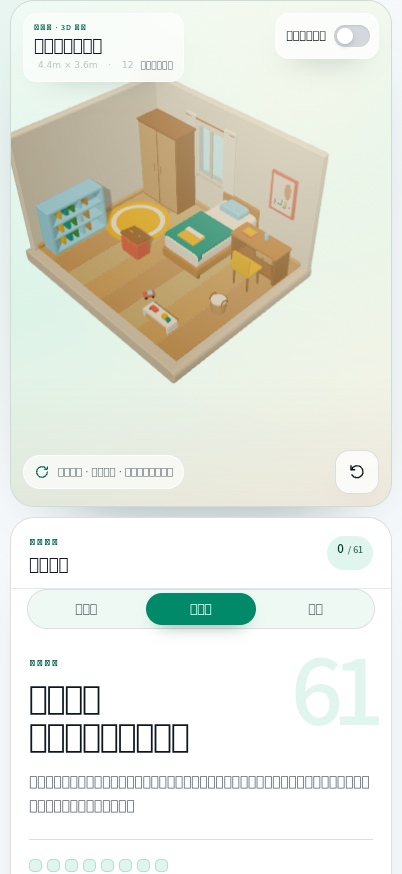

打开英文标签，可见标签只投影当前房间的 12 件物品：

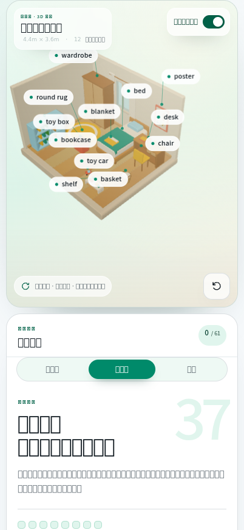

主卧（4.6m × 3.6m，12 件）：

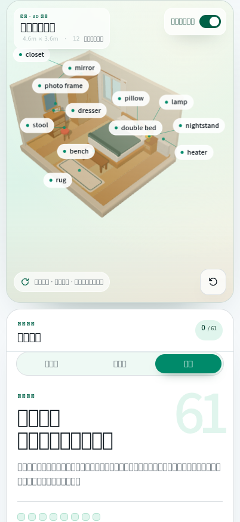

桌面宽的宿主布局（1440 × 900）：房间标签在 3D 舞台上方、宽屏收成 460px 工具栏，统计格按房间显示 37 / 12 / 12：

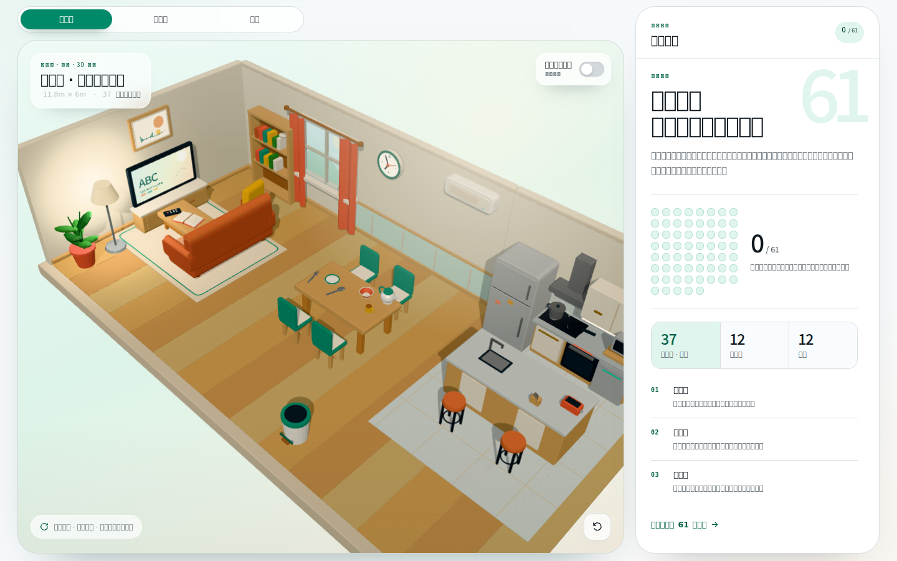

> 说明：截图里中文显示成方框是容器缺 CJK 字体的原因（chromium 未装 Noto Sans CJK），几何、配色、布局、英文标签都是真实渲染结果。

### 12.4 共面 z-fighting（2026-10-26 真机反馈）

真机上主卧床尾有一片区域一直在闪。原因是**两块面片正好落在同一个深度平面**：被子折边（`quiltDark`）的 +z 端面和床垫（`sheet`）的 +z 端面都在 `z = 0.21`，法线同向、面积 0.28 ㎡，深度缓冲分不出先后，渲染器每帧按浮点误差随机选一个（相机阻尼让画面一直在微动，所以看起来「一直闪」）。

排查方式：把三间房的几何离线建出来，遍历所有可见网格算世界 AABB，找「同向、同平面、有重叠」的面片对（排除 `colorWrite === false` 的拾取盒），得到候选列表后逐个改。修复：

| 位置 | 原状 | 改法 |
| --- | --- | --- |
| 主卧床尾 | 被子折边端面 = 床垫端面（0.28 ㎡） | 折边内缩到 `z 0.79…0.91`，并抬高 `y 0.62…0.78`（露出一点，像翻折的被子） |
| 卧室窗台 | 窗下墙顶面 = 窗台顶面（主卧 0.17 ㎡ / 儿童房 0.12 ㎡） | 窗下墙高度 `win.y0 - 0.06`，顶部藏进窗台里 |
| 西北角 | 西墙顶面 = 北墙顶面 | 西墙矮 2cm |
| 儿童房书柜 | 顶/底板、背板的端面与侧板端面共面 | 顶/底板 1.4 → 1.32 宽、背板 1.06 高，全部内缩 2cm；顶板下沉到 1.07 |

复检结果：三间房 AABB 扫描后，两间卧室 0 处同向共面；客餐厅剩 8 处（沙发扶手卷/绿植叶片/书脊），逐张 3× 截图确认这些面片要么被别的几何挡住、要么是圆柱体 AABB 造成的误报，未改动已上线的主屋几何。

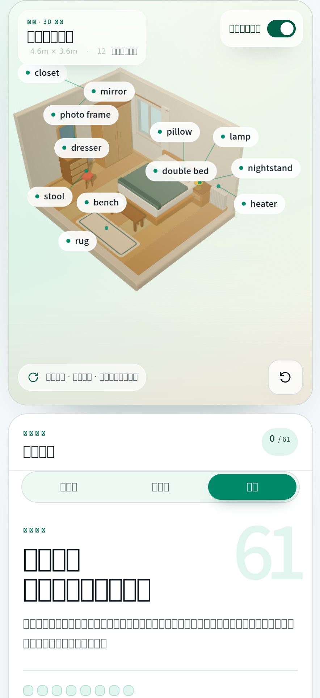

> 这类 bug 静态截图看不出来（同一帧里两个面片谁赢是确定的），但相机有阻尼微动，真机上就是一片闪烁。以后加家具时，让相接面**错开 1~2cm**、不要严丝合缝。

### 12.5 房间标签移到 3D 舞台上方（2026-10-26 真机反馈）

> 「客餐厅、儿童房、主卧是不是应该放到 3D 场景图的上面，比较符合使用习惯，方便切换」

座次改了：标签从学习面板顶部搬到 3D 舞台正上方，成为舞台列的第一行。

改动很小，因为当初担心的「挤占取景」在小屏上并不成立：`@media (max-width: 1000px)` 里舞台是 `height: 58dvh` 的**固定高度**（不是被兄弟元素挤出来的），所以在它上面加一行只会让整页高 58px，3D 画布和标签安全区一个像素都没少。宽屏则是 `.workspace` 定高网格，舞台用 `flex: 1` 吸收这 58px（1440×900 下舞台仍接近整屏高）。

| 点 | 处理 |
| --- | --- |
| 结构 | `main.workspace` 第一列包一层 `.stage-col`（flex column），`.room-tabs` 在 `.stage-card` 之前；面板里删掉原来的标签行 |
| 吸顶 | `.room-tabs { position: sticky; top: 0 }`——面板比一屏长，往下看词表时标签钉在原生标题栏下方，`stage-col` 到底才松手（实测滚动 300px 后 `tabsTop = 0`） |
| 宽屏 | `@media (min-width: 701px) { max-width: 460px }`，不铺满整列，收成一段工具栏 |
| 触控 | 小屏 `.room-tab` 高度 36px、字号 13px |
| 状态 | JS 全部按 `#roomTabs` 取节点，搬迁零改动；DOM 断言（61 id/61 圆点、切房间、词汇表跳转）复跑全绿 |

手机上的样子（402 × 874）：标签在舞台上方，下面依次是场景、单词面板；面板里不再有第二排标签。

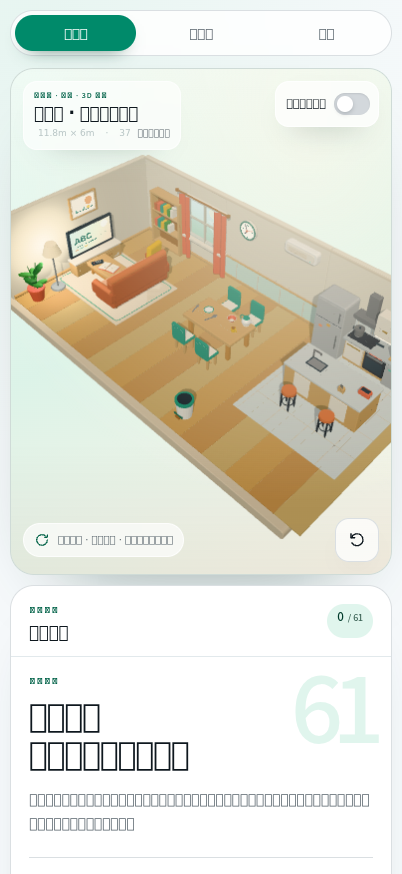

---

## 13. 卫生间 + 阳台扩建（2026-10-26）

### 13.1 设计来源与取舍

参考 open-design 输出 `.od/projects/2ab7c338-e4a6-4e47-9dbc-fb52f7099e38`：`wet-rooms-data.json` 是 24 件物品的权威数据（尺寸 / 高度 / 配色 / 儿童解释 / 例句），`room-wetroom-models.js` 是照着我们的 helper 签名写的 three.js 构建脚本（`box / cylinder / objectGroup / hit / material` 完全对得上，`wet-kit.js` 与本仓库 `room-models.js` 里的同名函数逐字节一致），`wet-rooms-design.html` 是版面与文案。

沿用 §12 的架构：**每间房建在自己的局部坐标系里（原点在房间中心，北墙 z = -1、西墙 x = -1.2），同一时刻只显示一间**，切换只是 `group.visible`。新增两间：卫生间 2.4 × 2.0（4.8 ㎡）、阳台 3.6 × 1.4（5.04 ㎡），各 12 件可点物品，全屋 61 → 85。

与设计稿的差异（都是「画出来才发现」的问题）：

| 差异 | 原因 |
| --- | --- |
| 阳台南侧不砌 0.6m 实心矮墙，改 6cm 挡水边 + 细线栏杆（0.92m 扶手 / 0.12m 下横杆 / 4 根立柱） | 相机俯角 41°，0.6m 高的栏板会把镜头脚下 0.4m 的地面整片遮住：布袋（z 0.50）、拖鞋（z 0.52）、皮球（z 0.28）全部看不见。玻璃栏板虽然透光，但会把镜头到东头扫帚那一片染成绿色 |
| 阳台物品重排，只留 1 把折叠椅、1 只水桶 | 设计稿 `deck_chair_2` 这个 id 用了两次（实际 3 把椅子、2 只桶），24 件里只有 11 个不重复单词。改为：椅子 1 把、水桶只留 `mop_bucket`，新增 `mop`（拖把）、`hanger`（挂在晾衣杆上的衣架）、`ball`（皮球） |
| 卫生间补一块 0.56m 壁板（不可点）+ 两只钢支架；毛巾改挂到浴缸上方毛巾杆 | 设计稿的洗手台比我们宽，肥皂 / 洗发水 / 毛巾按它的坐标摆过来就成了「悬在半空」。壁板把这两件托住，毛巾贴到北墙 |
| 洗手盆水面压到缸沿下 1cm | 原坐标下水面比盆沿高 1.2cm，放大看是一层浮在外面的青色圆片 |
| 马桶东移 10cm、南移 31cm | 水箱按原坐标嵌进西墙 4cm；马桶与洗手台柜在 z 方向原本互相穿模 26cm（柜身到 z = -0.32，马桶从 z = -0.61 起）。挪到柜身以南、留 2cm 间隙后，两者屏幕拾取盒的重叠从 77% 降到 18% |
| 卫生间北墙分两段：西段米白、东段浅蓝 | 设计稿的双色瓷砖墙。两块墙板错开 2mm，避免共面 |

### 13.2 数据与代码改动

| 文件 | 改动 |
| --- | --- |
| `assets/scene-data.js` | 新增 24 件物品（`category: bathroom / balcony`，`room` 同名字段）；`rooms` 补 `bathroom`（`卫生间 · 3D 场景` / `卫生间英语探索` / `2.4m × 2.0m` / `小房间里藏着洗手、洗澡、照镜子三件大事。`）与 `balcony`（`3.6m × 1.4m` / `一半是家，一半是天空：洗衣机、花盆和扫帚都在这儿。`）；`roomOrder` 补两间；`ROOM_BY_CATEGORY` / `categories` 同步 |
| `assets/room-models.js` | 新增 `WET_PAL`（瓷砖 / 浴水 / 木纹地砖 / 栏杆 / 土壤 / 叶绿）、`WET_CEIL = 2.6`、`WET_PICK_PRIORITY`（24 个 id 的拾取优先序）、`tiledShell()`（双色瓷砖墙 + 踢脚线）、`slantedBar()`、`buildBathroom()` / `buildBalcony()`（各 12 件，数量不符直接 throw）、`buildWetRooms()`；`ROOM_FRAMES` 补两套取景参数，`exports` 补 `buildWetRooms` |
| `assets/room-scene.js` | 新增 `ROOM_BATHROOM` / `ROOM_BALCONY` 两个 Group，`buildWetRooms()` 建进去，`roomObjects` / `roomHitboxes` 与 `this.objects` 一并追加 |
| `index.html` | 标签补到 5 个；统计格补到 5 格；`data-total` 61 → 85、`#sceneCount` 37、品牌小字 `3D 五间房`、`<title>` / meta / canvas `aria-label` / 无障碍说明全部改成五间房；欢迎区背景大数字改由 `data-watermark` 提供（原来写死在 CSS `content: '61'`） |
| `assets/room.css` | `.room-tabs` 允许横向滚动（`overflow-x: auto` + 隐藏滚动条 + `min-width: 56px` 兜底），402px 上五格仍等分一行（每格 71px），记不住位置的窄屏才退化成滑动 |
| `assets/room-panel.css` | 统计格五等分（`.room-stats { grid-template-columns: repeat(5, …) }`），首格 26px、其余 22px，名称 10.5px 且不换行；`<360px` 再降一档（18px / 9.5px） |
| `assets/room-app.js` | `CATEGORY_ORDER` / `ROOM_ORDER` 补两间；新增 `revealTab()`——切房间后把当前胶囊滚进视野（只动 `scrollLeft`，不整页滚）；`updateStaticCounts()` 同步 `data-watermark` |
| `utils/RoomEnglishValidation.ets` | `ROOM_OBJECT_IDS` 补 24 个 id（85 条），`FOCUS_MODES` / `FOCUS_HINT` 补 `bathroom` / `balcony` |
| `components/room/RoomEnglishCard.ets` | `ROOM_OBJECT_TOTAL` 61 → 85；`focusRoom()` 把 `bathroom` / `balcony` 也转成 `setRoom()` 注入 |
| `config/BuiltinTools.ets` | schema `focus` 枚举补两个值，描述里的区域件数与 id 清单补齐；工具描述改「五间房 85 件」 |

### 13.3 两间房的平面

卫生间（北墙自西向东 = 洗手台 / 壁板 / 浴缸，西墙自北向南 = 镜子 / 马桶 / 卷纸架）：

| 物品 | 位置 | 说明 |
| --- | --- | --- |
| `washbasin` | 西北角，台面 0.86m | 木柜 + 奶白台面 + 盆 + 龙头，台面西端留给牙刷杯 |
| `mirror_bath` | 西墙，台面上方 14cm | 薄板 + 两盏镜前灯 |
| `toothbrush` | 台面西端 | 青绿杯子 + 两支斜插的牙刷（一黄一珊瑚） |
| `soap` / `shampoo` | 北墙壁板（0.88m 高） | 一只浅碟 + 一块方皂；方肩圆身压嘴瓶 + 腰封 |
| `bathtub` | 北墙东段，缸沿 0.52m | 三块矮挡板围出缸体 + 水面 + 龙头 + 小黄鸭（不可点） |
| `shower` | 浴缸东头，立杆 1.42m | 竖杆 + 横臂 + 莲蓬头 + 彩色手柄，房间里唯一的「竖线顶圆盘」 |
| `towel` | 北墙、浴缸中段上方 1.16m | 毛巾杆 + 垂下的毛巾（近侧一条奶白折边） |
| `toilet` / `toilet_paper` | 西墙中段 / 马桶前侧地面 | 水箱贴墙、盖板立起、坐圈里的水面是青蓝；纸卷架杆从卷芯穿过。都在洗手台柜以南，z 方向互不穿模 |
| `bath_mat` / `scale` | 地面前部 | 两件都贴地，不挡任何东西 |

阳台（北墙 = 建筑外墙，西墙 = 侧墙，南侧与东侧是栏杆）：

| 物品 | 位置 | 说明 |
| --- | --- | --- |
| `washing_machine` | 西北角 | 圆窗 + 控制面板 + 滚筒里的青色，房间里唯一的大白箱 |
| `mop_bucket` / `mop` / `broom` | 洗衣机前 / 西头 / 东头 | 桶 + 拧水篮；拖把斜靠西侧；扫帚靠东侧玻璃栏杆 |
| `watering_can` | 北侧地面 | 提手 + 长嘴 |
| `deck_chair` / `side_table` | 中段 | 珊瑚色折叠椅 + 木纹圆边桌 |
| `flower_pot` | 东段 | 陶盆 + 三团叶簇 |
| `hanger` | 北墙晾衣杆上（1.60m） | 木色三角衣架，钩子搭在钢杆上 |
| `bag` / `slippers` / `ball` | 南侧地面 | 白布袋、珊瑚色拖鞋、珊瑚色皮球，三件都贴地 |

拾取优先级（`WET_PICK_PRIORITY`）解决「小物件站在大物件前面」：**两个数组都按它排序**，`raycaster.intersectObjects` 等距时按数组顺序取第一个，所以小物件（肥皂 / 洗发水 / 皮球）不会被身后的浴缸 / 洗衣机抢走点击。

### 13.4 取景

| 房间 | `bounds` | `target` | `fitMin` | `fitScale` | 结果（402 × 874，画布 380 × 505） |
| --- | --- | --- | --- | --- | --- |
| 卫生间 | ±1.2 / ±1.0 | -0.10, 0.60, -0.16 | 4.9 | 1 | 物品包围盒 331 × 310px，最小的可点物品 44 × 37px（肥皂） |
| 阳台 | ±1.8 / ±0.7 | 0.06, 0.78, -0.06 | 4.6 | 0.93 | 包围盒 317 × 291px，最小的 41 × 62px（水桶） |

阳台的 `fitScale` 必须小于 1：3.6m 长边的对角线在画面里最占宽度，按 1.0 算出来的半径会把整间房缩到只占屏宽 78%。`target.y` 也比卧室低（0.78 对 0.78——卧室 2.8m 墙、阳台 2.6m 墙，压到 0.78 才让画面重心落在楼板和家具上）。

### 13.5 验证

headless Chromium（swiftshader 软渲染）+ Playwright，402 × 874 / 360 / 320 / 1024 × 760 四档：

| 检查 | 结果 |
| --- | --- |
| 数据 | `scene-data.js` 85 条 id 互不重复；房内件数 37 / 12 / 12 / 12 / 12；`kidDefinition` 均 ≤ 20 字；房内单词无重复 |
| 投影尺寸 | 卫生间 12 件全部 ≥ 44 × 37px，阳台 12 件全部 ≥ 41 × 52px（阈值 40 × 30） |
| 标签 | 两间房各 12 个标签，两两不重叠，拖动/缩放后仍不重叠（沿用既有布局算法） |
| 拾取重叠 | 屏幕包围盒重叠 > 18% 的只剩「一前一后贴着的件」（浴缸 ∩ 花洒 35%、洗衣机 ∩ 水桶 69%、镜子 ∩ 牙刷杯 55%、肥皂 ∩ 洗发水 50%），均按 `WET_PICK_PRIORITY` 指定归属；马桶 ∩ 洗手台从 77% 降到 18% |
| 共面扫描 | 两间房 0 处「同向共面」；剩下的都是楼板边 ∩ 墙脚、物品贴地这类被遮挡的贴合面（与前四间房同类） |
| 布局 | 402px：5 个胶囊各 71 × 36px、统计格各 68px、`document.scrollWidth === innerWidth`（无横向溢出）；320px：胶囊保底 56px、标签条可横向滚动、统计格降到 18px |
| 构建 | `hvigorw assembleHap` BUILD SUCCESSFUL（无新增告警）；`BuiltinTools.ets` 27 段 `rawSchemaJson` 全部 `JSON.parse` 通过 |

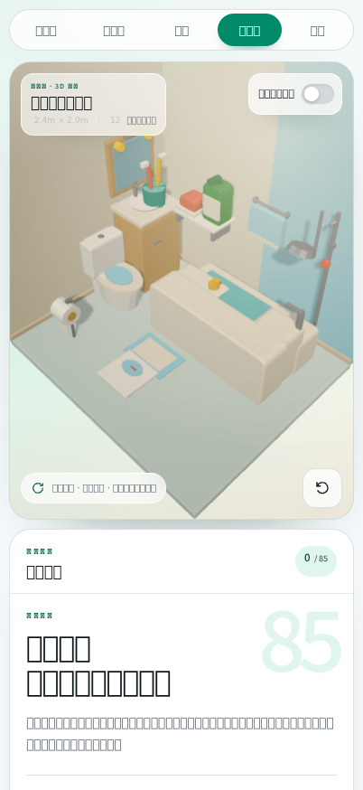

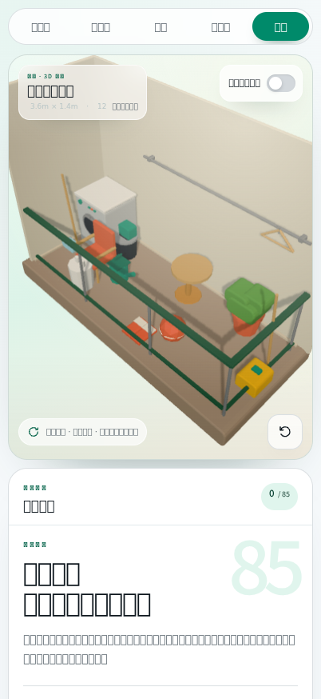

打开英文标签后（左：卫生间，右：阳台）：

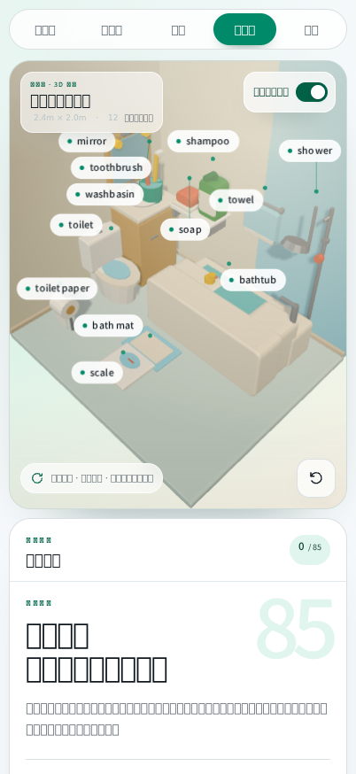

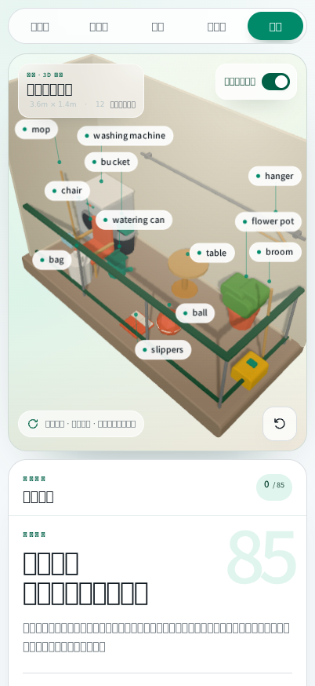

宽屏 1024 × 760（五格统计 + 五间房标签同排）：

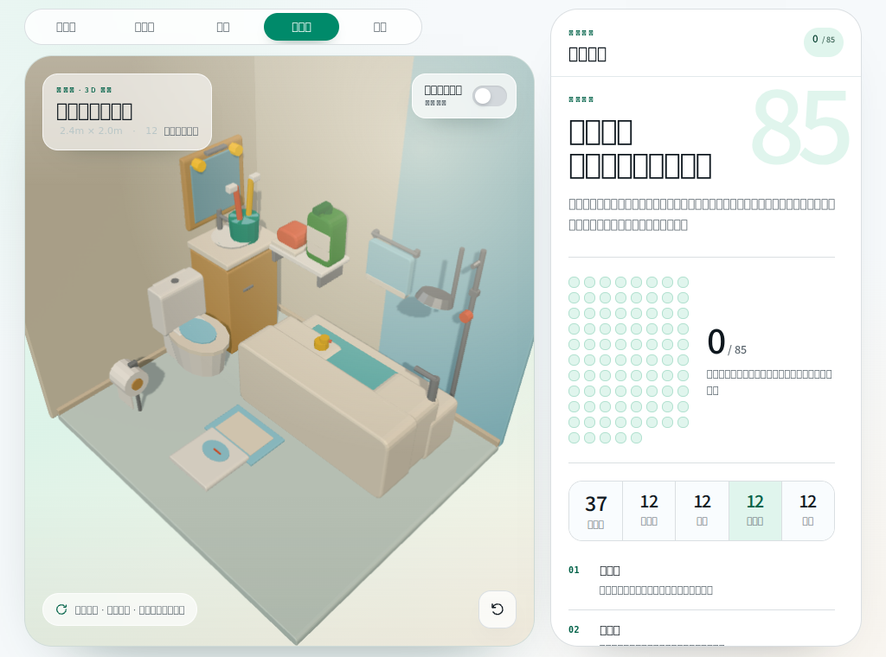
