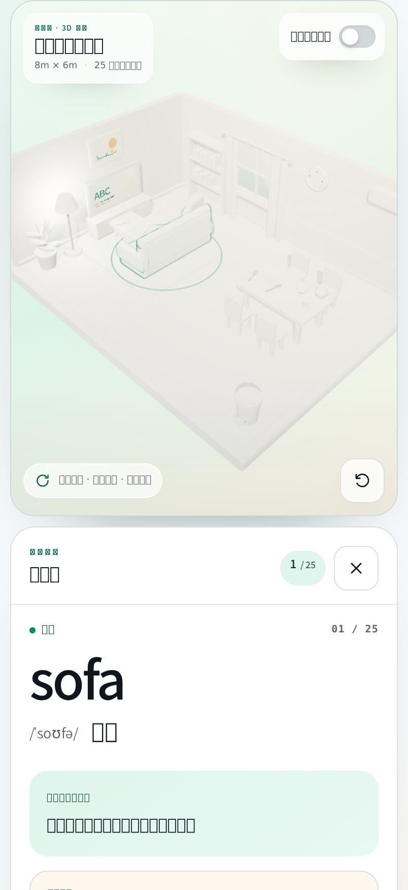
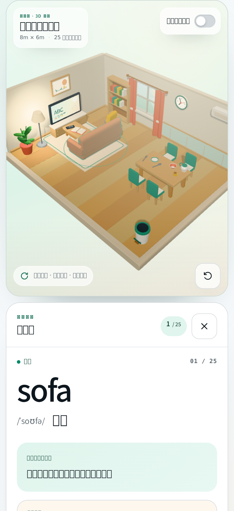
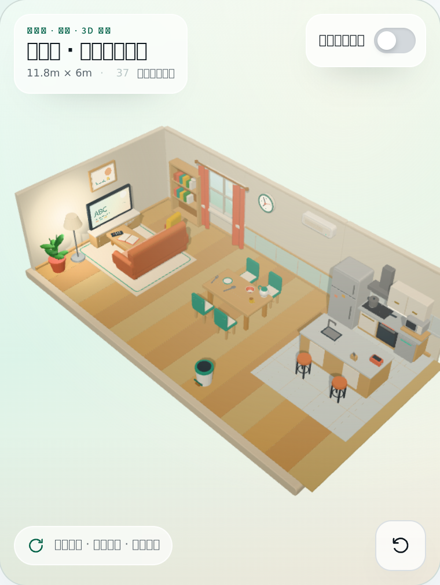
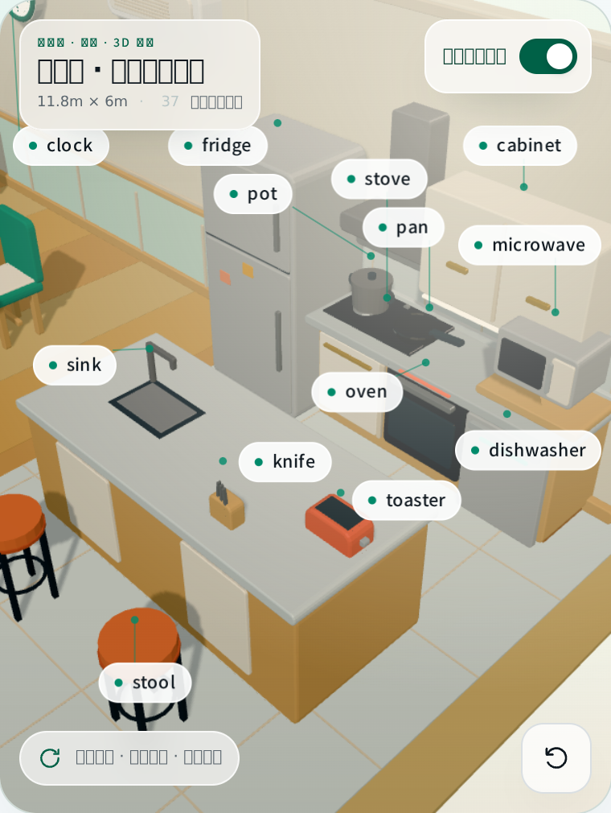
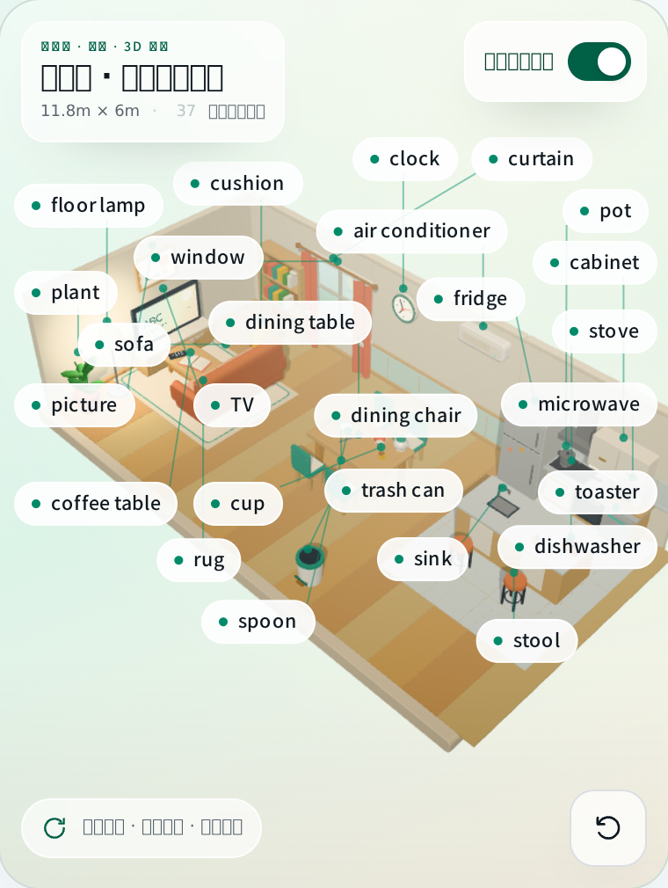

# room_english · 客餐厅 + 厨房 3D 英语探索 设计（2026-10-24，2026-10-25 扩建厨房）

## 1. 背景与目标

小星英语老师需要一个「能把孩子带进房间」的词汇教学工具：不是看图选词，而是让孩子在可旋转的 3D 客餐厅里点家具、听英文发音、看单词卡，把单词和实物对应起来。

原型来自 open-design（`kids-room-3d-english`，8m × 6m 低多边形客餐厅、25 件可点击物品、three.js 0.185 本地渲染）；2026-10-25 参考同系列厨房原型（`96a8ae19-…`，东北角开放厨房方案）向东扩出开放厨房，房间变成 11.8m × 6m、37 件可点击物品（客厅 15 + 餐厅 10 + 厨房 12，见 §11）。本设计把它落到鸿蒙原生壳里，作为一个内置工具 `room_english` 挂在 `ToolRegistry` 上，由小星英语老师在「呈现」环节调用。

## 2. 方案选型

| 方案 | 结论 | 理由 |
| --- | --- | --- |
| **Web 容器 + rawfile 本地页面（采用）** | `Web` 组件加载 `resource://rawfile/room3d/index.html`，three.js / 字体 / CSS 全部打包在 rawfile，无网络依赖 | 原型是 three.js 网页，1:1 保真、零几何重写；项目里 `mermaid` / `document-parser` 已用同法加载 rawfile 页面并加载相对子资源，路径可靠 |
| ArkGraphics 3D 原生场景 | 不采用 | 原型是程序化低多边形几何（非 glTF），要重建成 glTF 资源 + 原生拾取/标签投影，工作量大且丢失原型视觉 |
| 原生 ArkUI 伪 3D | 不采用 | 旋转相机、悬停高亮、标签避让都需重写，效果不如原型 |

**边界**：ArkWeb 没有 `speechSynthesis`，发音改走原生 TTS 桥；原生标题栏接管「进度 + 我学会了」，页面切到 host 布局（隐藏自带品牌栏）。

## 3. 数据：37 个物品

`sofa / coffee_table / tv / tv_stand / remote_control / rug / cushion / floor_lamp / bookshelf / book / plant / curtain / window / picture / clock`（客厅 15）+ `air_conditioner / trash_can / dining_table / dining_chair / plate / bowl / cup / spoon / fork / kettle`（餐厅 10）+ `fridge / stove / oven / sink / pot / pan / toaster / microwave / dishwasher / cabinet / knife / stool`（厨房 12）。

每个物品带 `word / phonetic / zh / kidDefinition / example / category`，唯一数据源是 `rawfile/room3d/assets/scene-data.js`，工具侧校验白名单是 `utils/RoomEnglishValidation.ets` 的 `ROOM_OBJECT_IDS`。**两处必须同步**（单元测试断言 37 条）。

> 原型把空气调节器/垃圾桶归到餐厅（10 条），保持原分组不动。
> 网页内的总数、分类计数、进度分母全部由 `scene-data.js` 派生（`data-total` / `OBJECTS.length` / `categories[x].count`），只有 `RoomEnglishCard` 的原生标题栏需要常量 `ROOM_OBJECT_TOTAL`。

## 4. 工具契约

### 4.1 参数（schema 见 `config/BuiltinTools.ets`）

| 字段 | 类型 | 必填 | 说明 |
| --- | --- | --- | --- |
| `skill_key` | string enum `english_vocab` | 是 | 画像维度固定为英语词汇 |
| `focus` | string enum `living` / `dining` / `kitchen` / `all` | 否 | 默认 `all`，本次重点区域（当前只进 payload + 文案，不做场景裁剪） |
| `words` | string[] | 否 | 本次重点词 id，最多 8 个；命中后自动选中第一个词（2026-10-24 起英文标签默认隐藏，由孩子点场景「显示英文标签」开关手动打开；选中物品即自动朗读） |

### 4.2 回执（`ToolResult.result`）

```json
{
  "completed": true,
  "explored_count": 7,
  "words": ["sofa", "tv", "rug"],
  "focus": "all",
  "skill_key": "english_vocab",
  "cancelled": false
}
```

- 孩子点「我学会了」→ `completed: true` + 已点开物品清单。
- 直接关掉 sheet → `completed: false, cancelled: true`（ChatPage 的 `onDisappear` 兜底）。
- 预校验失败（坏 JSON / skill_key 错 / 非法 focus / 非法 word id / 超过 8 个词）→ `{ error: "validation_failed", should_retry: true }`，AI 自行修正。

## 5. 前端结构

`components/room/RoomEnglishCard.ets`

```
Column
├─ HeaderBar()            原生：标题 + 已收集 N/37 + 「我学会了」
└─ Stack
   ├─ Web(resource://rawfile/room3d/index.html)
   ├─ LoadingProgress     页面就绪前的「正在布置小房间…」
   └─ 错误面板 + 重新加载
```

- `isAnswered` 模式下不加载 Web，只渲染收集到的单词 chips（时间线回看用；实际时间线由 MessageBubble 的 `RoomEnglishStepContent` 显示）。
- 页面就绪（`onPageEnd`）后按 `words` 注入 `window.WordRoomApp.setLabels(true)` + `select(first)`。

### 5.1 桥协议（`RoomNativeBridge`，`javaScriptProxy` 注入）

| 方向 | 方法 | 说明 |
| --- | --- | --- |
| Web → 原生 | `speak(word, zh)` | 返回 `'true'` 表示已交给原生 TTS；原生先念 `zh`（中文意思）再念 `word`。Web 侧据此跳过 `speechSynthesis` |
| Web → 原生 | `stopSpeak()` | 关闭单词卡 / 切词时停播 |
| Web → 原生 | `onReady()` | 3D 场景首帧就绪（Web 侧 loader 自行收起） |
| Web → 原生 | `onSelect(id, word)` | 选中物品，原生累计已收集单词 |
| Web → 原生 | `onProgress(idsJson)` | Web 侧 `discovered` 集合变化，原生以它为准覆盖进度 |

- Web 侧封装在 `assets/room-app.js` 的 `bridgeCall()`，桥缺失时全部降级为 no-op（浏览器里打开原型仍可用）。
- 原生侧状态写回统一走 `UIContext.runScopedTask`，避免 Web 代理回调线程直接改 `@Local`。
- `onSelect` / `onProgress` 同时带 id 与展示词：`words` 回执用 id（与工具白名单同口径），UI chips 用英文单词。

### 5.2 host 布局

`assets/room-host.css` 在 `body.room-host` 下隐藏页面自带 `.topbar` / `.skip-link`，`.workspace` 高度改 100dvh；原生 HeaderBar 顶替。该 class 由 `room-app.js` 无条件添加（这份 index.html 只在小词屋 sheet 里加载）。

## 6. 授星决定

**Decision：room_english 不授星**（与 `map_card` 一致）。

- 它是讲解型工具，没有对错判定；按项目规则「讲解课不是题」不记 `star_event`。
- 星星由小星老师在同一节课的后续 `english_quiz` / `matching_pairs` 给出（系统提示词里已明确写「room_english 本身不授星」）。
- 因此 **不改** `models/StarEventModels.ets` 与 `services/StarRewardService.ets`（10 处 drift 点全部跳过），也不出现在星星明细页。

## 7. 接入点（对照 `adding-mini-game-tool` 10 步配方）

| 步骤 | 文件 | 改动 |
| --- | --- | --- |
| 1 | `utils/SearchToolIdentityUtils.ets` | `ROOM_ENGLISH_TOOL_ID` + `isRoomEnglishFunctionName` + 加入 `isInteractiveQuizFunctionName` |
| 2 | `config/BuiltinTools.ets` | import、`RoomEnglishArgs`、`RoomEnglishExecutor`、`createRoomEnglishToolDefinition`、`createRoomEnglishToolConfig`、register、`getBuiltinToolIds` |
| 3 | `services/ToolExecutionService.ets` | import、`handleRoomEnglish`、dispatch（在 `resolveToolId` 之前） |
| 4a | `models/StarEventModels.ets` | **跳过**（见 §6） |
| 4b | `services/StarRewardService.ets` | **跳过**（见 §6） |
| 5 | `models/AssistantModels.ets` | import、默认助手 + 小星英语老师白名单、两段提示词 |
| 6 | `components/room/RoomEnglishCard.ets` | 新建（Web 容器 + 桥 + 完成回执） |
| 7 | `components/MessageBubble.ets` | import、`onOpenRoomEnglishSheet` @Event、待答横幅、7 处 step 判定、时间线回看 |
| 8 | `pages/ChatPage.ets` + `components/chat/ChatMessageListSection.ets` | 全屏 sheet 状态 / builder / `onDisappear` 兜底，事件透传 |
| 9 | 持久化 | **不需要**：仅 rawfile 静态资源，无用户数据 |
| 10 | 校验 | JSON.parse 26/26、`node --check` 4 个 JS、`assembleHap` 通过 |

## 8. 验收清单

- [ ] 小星老师调用 `room_english` 后，对话里出现「客餐厅 3D 英语探索 · 点击走进房间」横幅
- [ ] 点横幅打开全屏 sheet，3D 客餐厅渲染出来，可拖动旋转 / 双指缩放
- [ ] 点沙发 → 右侧（手机为下方）出现单词卡：sofa / /ˈsoʊfə/ / 沙发 / 儿童解释 / 例句
- [ ] 点物品后不用点「听发音」即自动听到原生 TTS 慢速（0.8）英文；「听发音」按钮保留作重播
- [ ] 再点电视 → 单词卡切换，不叠加；点空白处 → 关闭单词卡
- [ ] 原生标题栏进度从 0/37 递增；点「我学会了」→ sheet 关闭，AI 收到 `explored_count` 与 `words`
- [ ] 时间线里这条工具步骤可展开，显示收集到的单词 chips
- [ ] 传 `words: ["sofa"]` 时进房间自动选中沙发并自动朗读；英文标签默认不显示
- [ ] 直接下拉关闭 sheet → AI 收到 `cancelled: true`，不报错
- [ ] 非法 word id（如 `bathtub`）→ 工具返回 `should_retry`，AI 改用合法 id

## 9. 已知边界

- 3D 依赖 WebGL；极低端设备关闭硬件加速时显示「3D 房间没有打开」+ 重新加载，词汇表仍可在网页内使用（当前 sheet 直接展示错误面板，未做词汇表兜底）。
- 系统 TTS 必须已初始化（`EntryAbility` 已 init）；引擎不可用时返回 `'false'`，Web 侧回落到 `speechSynthesis`，再不行提示「当前设备不支持语音朗读」。
- `focus` 暂不裁剪场景（原型不支持按分类隐藏），只进回执与提示词。
- 房间变长后默认视角半径约 22（手机竖屏 402 × 874），厨房物品在默认缩放下偏小；已放宽缩放范围（`zoomRange()` 跟 `fitRadius()` 联动，可拉近到约 8），双指掰合即可贴近厨房。默认俯角也从 37° 收到 41°（`phi` 0.93 → 0.85），长条形户型在竖屏里更饱满。
- 深色模式下 Web 页自身主题固定浅色（原型只做了浅色），sheet 背景与原生标题栏会跟随深色，页内为浅色卡片，属预期。

## 10. 复原配色（2026-10-24 修复：整间房发灰）

**现象**：真机上 3D 房间几乎只有灰白色，家具分不出颜色。

**根因**：`room-models.js` 的 OKLCH→sRGB 转换把调色板里的 `L`（百分比，70–99）当成 0–1 直接立体方，三次方后全部溢出并被 clamp 成纯白——所有材质都成了 `#ffffff`，场景只剩灯光和阴影，所以是灰度图。这个 bug 在原型的网页版里同样存在（`linearSrgb` 与原型完全一致），不是 ArkWeb 的问题：本地 Chromium 渲染同一页面测得画面平均彩度 0.036、95% 像素近乎无色，与真机截图 0.034 / 98% 一致。

**修复**（三处，均在 rawfile 内）：

| 文件 | 改动 | 理由 |
| --- | --- | --- |
| `assets/room-models.js` | `lightness = L / 100` 后再参与 OKLCH→线性 sRGB 计算 | 真正的 bug：L 量纲错误导致全部材质纯白 |
| `assets/room-models.js` | 新增 `CHROMA_GAIN = 1.4`，`color()` 把彩度放大 1.4 倍（上限 0.4） | 原型配色是为大屏调的柔低彩度，缩到手机上半屏后颜色读不出来 |
| `assets/room-scene.js` | `ACESFilmicToneMapping` → `NeutralToneMapping`；曝光 1.05→1.0；hemi 1.55→0.85、key 2.35→1.45、fill 0.72→0.38、backFill 0.38→0.20 | ACES 会把「高亮 + 低彩度」的场景压成灰白；原光强叠加后过曝（1.55+2.35+0.72+0.38≈5.0） |

**效果**（同一视角、同一相机，`deviceScaleFactor: 2`）：

| | 画面平均彩度 | 近乎无色像素 | 最饱和色 |
| --- | --- | --- | --- |
| 修复前 | 0.032 | 95% | `#9ec1b0` 淡灰绿 |
| 修复后 | 0.144 | 45% | `#d89051` 陶土橙 |




**没有做的**：没有替换调色板本身。房间仍是原型那套「暖木色 + 鼠尾草绿 + 陶土色」的柔和北欧配色，地板/墙面本来就是暖中性色，所以整体基调偏米色；如果希望更「儿童房」的跳色（蓝/黄/粉撞色），那是配色改版，需另开一轮，参照物见 §11。

## 11. 厨房扩建（2026-10-25）

### 11.1 目标与取舍

原型里的 3D 房间只有客餐厅，孩子学家居词时「厨房」这一大类（fridge / stove / sink / pot / pan …）没有可点的实物。参考 open-design 厨房原型（单页 HTML，18 件厨房物品 + 平面「工作台」风格）后，决定在**同一个 3D 房间内向东扩出开放厨房**，而不是再开一个新页面：

- 保持「一间房就可以讲完」的叙事：孩子在客厅坐下 → 走到餐桌 → 进厨房，视角连续。
- 复用同一套 `RoomExperience`（相机/拾取/标签/桥），不新增 Web 容器，sheet 逻辑零改动。
- 词汇来源仍是 `scene-data.js` 单一数据源，原生侧只加白名单与 `focus` 枚举。

未采纳：把厨房做成第二个页面（切换成本高、老师讲「走进厨房」会断）、把厨房放在房间南侧（南墙是剖切面，会被相机挡）。

### 11.2 空间布局

房间底面从 `8.38 × 6.38` 扩到 `11.9 × 6.38`（x: −4.19 → 7.65），北墙、踢脚线、收口线同步延长；厨房占 x 4.2 → 7.65 的东北角，地面铺 0.84m 方砖（`RGB.tile` + 灰缝）与客餐厅木地板分开，北墙加石材压条 + 浅色墙砖。

| 家具 | 位置 (x, z) | 尺寸 | 说明 |
| --- | --- | --- | --- |
| 橱柜（柜体 + 石材台面） | 6.31, −2.70 | 2.0 × 0.6 × 0.87 | 一字型沿北墙，台面 2.14 × 0.72 @ y0.92 |
| 冰箱 fridge | 4.75, −2.58 | 0.92 × 0.7 × 1.94 | 台面西端独立高柜，两门 + 把手 + 磁贴 |
| 灶台 stove | 5.70, −2.68 | 0.8 × 0.48 | 黑玻璃面板 + 2 个深色炉圈 + 3 个旋钮 |
| 烟机 hood（装饰） | 5.70, −2.86 | 0.86 × 0.4 | 1.56m 高，含烟管 |
| 锅 pot / 平底锅 pan | 5.50 / 5.98, −2.72 / −2.66 | ⌀0.29 / ⌀0.32 | 坐在灶台玻璃上（y = 台面 + 0.026） |
| 烤箱 oven | 6.34, −2.36 | 0.64 × 0.64 | 嵌在柜体前脸，深色玻璃门 + 拉手 |
| 洗碗机 dishwasher | 6.98, −2.36 | 0.6 × 0.76 | 不锈钢面板 + 指示灯条 |
| 吊柜 cabinet | 6.60, −2.80 | 1.2 × 0.72 × 0.36 | y1.32–2.04，双门 + 黄铜拉手 + 柜底灯带 |
| 微波炉 microwave | 7.04, −2.62 | 0.54 × 0.38 | 站在 0.99m 小搁板上（搁板属装饰） |
| 中岛 island（装饰） | 5.95, −0.86 | 2.4 × 1.05 × 0.92 | 木柜体 + 米白门板 + 石材台面 |
| 水槽 sink | 5.40, −0.88 | 0.64 × 0.48 | 中岛台面上：不锈钢盆口 + 深色盆底 + 鹅颈龙头 |
| 烤面包机 toaster | 6.95, −0.88 | 0.3 × 0.19 × 0.19 | 中岛台面东端，橙色机身 |
| 刀座 knife | 6.45, −0.54 | 0.16 × 0.1 | 中岛台面南沿，木座 + 3 把刀 |
| 吧台凳 stool | 5.95, +0.18 | 2 × ⌀0.4 | 中岛南侧两把，座高 0.62 |

相机随之改成数据驱动：`WordRoomModels.bounds` 提供 `centerX / halfWidth / halfDepth`，`room-scene.js` 的 `orbit.target`、`fitRadius()`、`zoomRange()` 全部读它（原来写死的 `4.35 / 3.55 / 12.3..18.4 / 9.2..18.8` 会让 11.8m 的房间卡在取景外）。

### 11.3 新增单词（12）

| id | word | 音标 | 中文 | 儿童解释（≤20 字） | 例句 |
| --- | --- | --- | --- | --- | --- |
| fridge | fridge | /frɪdʒ/ | 冰箱 | 厨房里的大柜子，里面很冷。 | The milk is in the fridge. |
| stove | stove | /stoʊv/ | 灶台 | 上面有火，锅放在上面煮。 | Put the pot on the stove. |
| oven | oven | /ˈʌvən/ | 烤箱 | 关上门烤蛋糕和面包。 | The cake is in the oven. |
| sink | sink | /sɪŋk/ | 水槽 | 洗菜洗碗的水池，有龙头。 | Wash the apple in the sink. |
| pot | pot | /pɑːt/ | 锅 | 深深的锅，用来煮汤。 | The soup is in the pot. |
| pan | pan | /pæn/ | 平底锅 | 浅浅的锅，可以煎鸡蛋。 | Fry an egg in the pan. |
| toaster | toaster | /ˈtoʊstər/ | 烤面包机 | 放进面包，跳起来就好了。 | The toast pops out of the toaster. |
| microwave | microwave | /ˈmaɪkrəweɪv/ | 微波炉 | 一按就热，热牛奶很快。 | Heat the milk in the microwave. |
| dishwasher | dishwasher | /ˈdɪʃwɔːʃər/ | 洗碗机 | 把脏碗放进去，它会洗。 | Put the plates in the dishwasher. |
| cabinet | cabinet | /ˈkæbɪnət/ | 橱柜 | 墙上的柜子，收碗和杯子。 | The bowls are in the cabinet. |
| knife | knife | /naɪf/ | 刀 | 切菜用的刀，要小心。 | Cut the bread with a knife. |
| stool | stool | /stuːl/ | 吧台凳 | 高高的小凳子，坐在岛台边。 | I sit on the stool. |

`hood / island / 橱柜台面 / 吊柜灯带 / 地砖` 都是纯装饰，不可点，避免 37 个可点物体挤在 3m 台面上互相遮挡。

### 11.4 代码改动

| 层 | 文件 | 改动 |
| --- | --- | --- |
| 场景数据 | `rawfile/room3d/assets/scene-data.js` | +12 条 kitchen 物品、`categories.kitchen`、`roomSize` 改 11.8 × 6 |
| 模型 | `assets/room-models.js` | 房间/墙/踢脚延长；`buildKitchenShell / buildKitchenRun / buildIsland / buildHood` + 12 个 `build*` 与 `barStool()`；`ROOM`/`KITCHEN` 常量；`objects.length !== 37` 断言；导出 `bounds` |
| 场景 | `assets/room-scene.js` | 相机 target / `fitRadius()` / `zoomRange()` 读 `bounds`；缩放上下限不再写死 |
| 页面 | `assets/room-app.js` | 计数全量派生（`TOTAL`、`CATEGORY_ORDER`、`validateData` 分类自洽校验、`[data-total]` 填充、词汇表按 3 类渲染）；标签布局加「引线过长就隐藏」+ 选中项优先；去掉硬编码 25 |
| 样式 | `room-panel.css` / `room-dialogs.css` | 37 点网格改 8 列 13px；房间统计改 3 列；厨房分类徽标配色 |
| 页面文案 | `index.html` | 标题/描述/进度分母/统计卡/词汇表副标题加 `data-total`，新增「厨房物品」 |
| 原生校验 | `utils/RoomEnglishValidation.ets` | `ROOM_OBJECT_IDS` +12，`focus` 加 `kitchen` |
| 工具定义 | `config/BuiltinTools.ets` | schema `focus` 枚举 + 合法 id 说明按「客厅/餐厅/厨房」分组，描述改 37 件 |
| 原生 UI | `components/room/RoomEnglishCard.ets` | `ROOM_OBJECT_TOTAL = 37`，标题栏进度与空态文案改「客厅、餐厅、厨房」 |
| 提示词 | `models/AssistantModels.ets` | 「客餐厅与开放厨房」+ `focus` 可传 `kitchen` |
| 测试 | `ohosTest/…/RoomEnglishValidation.test.ets` | 37 条断言、kitchen focus、厨房 12 词全覆盖 |

### 11.5 验证

- `node --check` 4 个 rawfile JS；`rawSchemaJson` 26/26 `JSON.parse` 通过；`assembleHap` BUILD SUCCESSFUL。
- 无头 Chromium（swiftshader）跑交互：
  - 37 个 `.scene-label` 全部落在画布内，词汇表 37 行、3 组（15 / 10 / 12）。
  - 桥接 smoke：`onReady` → `onSelect(id, word)` → `onProgress(["fridge"])` → `speak("fridge", "冰箱")`；点开物品即自动朗读，先中文后英文。
  - 点击覆盖率（4px 采样射线）：厨房最小可点物体 11–25 格，与客厅原有小物件（fork 4、remote_control 5）同级或更好；无「完全点不到」的厨房物品。
  - 37 标签全开时引线不跨场景：超距标签自动隐藏，缩放后重新出现。
- 页面无横向滚动（`scrollWidth == clientWidth`），手机 402 × 874 下统计卡 3 列不折行。







### 11.6 手势与朗读（2026-10-25 迭代）

真机试用反馈修的三处：

| 反馈 | 原因 | 改法 |
| --- | --- | --- |
| 上滑反而「视角向下」 | `phi += dy`，与 three.js `OrbitControls`（拖下 = 相机抬高）相反 | 改成 `phi -= dy`，并把手感调慢（纵向 0.0028 rad/px、横向 0.005 rad/px） |
| 放大后只能看到中间，去不了客厅/厨房 | 缩放只改 radius，`target` 永远钉在房间中心 | 新增 `panByPixels()`：按屏幕像素换算出房间平面位移，`target` 夹在房间内（x 两侧各内缩 1.7m、z 各 1.3m）；**双指拖动随时可平移**，**放大到 `radius < fit × 0.85` 后单指拖动改为平移**（模式在按下时锁定，不会拖到一半切换） |
| 点物品只读英文 | 桥只传了 `word`；且 Web 侧只有点「听发音」才发声 | 点开物品自动朗读；`speak(word, zh)` 由原生先念中文再念英文（`SystemTtsEngine` 单次 `speak` 无法混读两种语言，故串两次调用，中文失败也会继续念英文） |

`resetView()` 同时修好：原来把 `target` 写死回 `(0, 0.86, 0.05)`、`phi` 写死 0.93，现在回到 `BOUNDS.centerX + 0.12` 与默认俯角 0.85。
